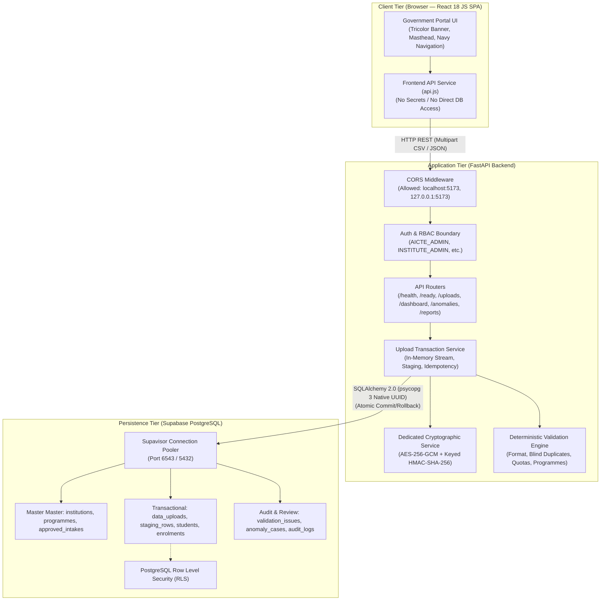

# APAARSetu System Architecture & Security Specification

## 1. High-Level Architecture Overview

APAARSetu is structured as an institutional digital service portal for AICTE-approved colleges:
- **Client Tier**: React 18 SPA (JavaScript, Vite) styled after Indian Public-Sector Portals (NIC, SwaaS, AICTE).
- **Application Tier**: Modular FastAPI backend with field-level cryptography, blind HMAC duplicate detection, and transactional persistence.
- **Persistence Tier**: Supabase PostgreSQL (15+) accessed via connection pooling with native UUID consistency.

---

## 2. Cryptographic Architecture (Field-Level Protection)

### A. AES-256-GCM for Recoverable Identifiers
- Applied to sensitive student identifiers (APAAR ID) before persisting into `students.apaar_encrypted`.
- **Nonce (IV)**: Cryptographically secure 96-bit (12-byte) random value generated per encryption (`os.urandom(12)`). Never reused with the same key.
- **Authenticated Additional Data (AAD)**: Binds the institutional ID (`institution_id`) to the ciphertext so ciphertext cannot be transposed across institutions.
- **Tampering Failure**: If ciphertext or nonce is modified, `AESGCM` raises `InvalidTag`, which fails closed as `CryptoTamperError` without leaking plaintext.

### B. Keyed HMAC-SHA-256 for Privacy-Preserving Matching
- Stored in `students.apaar_lookup_hash`.
- Prevents brute-force dictionary attacks against the small 12-digit number space.
- Normalized before computation (strips spaces, hyphens).
- Enables fast duplicate detection across batches without exposing plaintext or requiring decryption.

### C. Identifier Masking
- Plaintext 12-digit APAAR IDs are masked in normal API responses, UI tables, logs, and exports (e.g. `XXXXXXXX9012`).

---

## 3. Role-Based Access Control (RBAC) Matrix

| Operation | `AICTE_ADMIN` | `AICTE_ANALYST` | `INSTITUTE_ADMIN` | `INSTITUTE_OPERATOR` | `AUDITOR` |
| :--- | :---: | :---: | :---: | :---: | :---: |
| View Institutional Dashboard | ✅ | ✅ | ✅ (Own) | ✅ (Own) | ✅ |
| Upload Student CSV | ✅ | ❌ | ✅ (Own) | ✅ (Own) | ❌ |
| Inspect Row-Level Findings | ✅ | ✅ | ✅ (Own) | ✅ (Own) | ✅ |
| Resolve Anomaly Findings | ✅ | ❌ | ✅ (Own) | ❌ | ❌ |
| Export Compliance Reports | ✅ | ✅ | ✅ (Own) | ❌ | ✅ |
| Central Multi-Inst View | ✅ | ✅ | ❌ | ❌ | ✅ |
